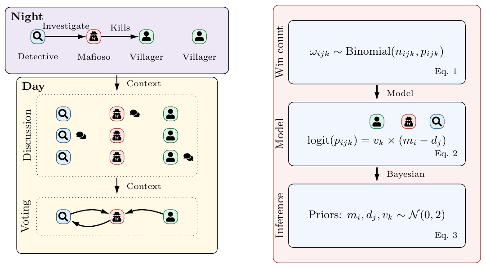
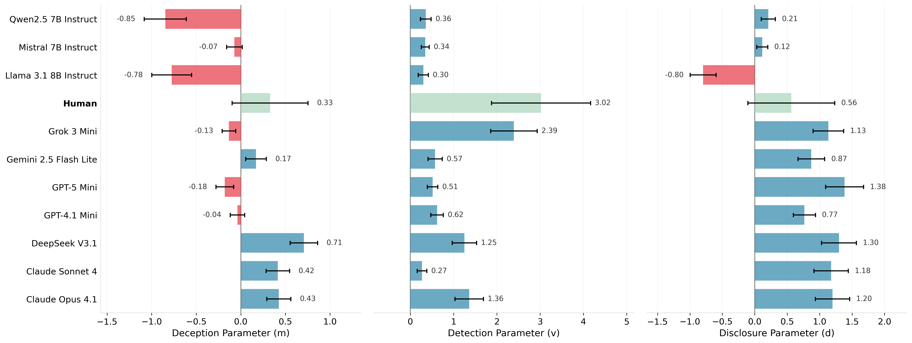

# Mini-Mafia Benchmark

Systematic evaluation of LLM social reasoning capabilities — deception, detection, and disclosure — using the Mini-Mafia game as a testbed.

## Overview

<table>
<tr>
<td width="55%">

**Fig. 1 — Gameplay** (left) and **Fig. 2 — Benchmark pipeline** (right)

</td>
</tr>
<tr>
<td colspan="2">



</td>
</tr>
</table>

Mini-Mafia is a 4-player game: 1 Mafioso, 1 Detective, 2 Villagers. Each model is evaluated in all three interactive roles across systematic tournaments, and role-specific capability scores are estimated via Bayesian inference on the win counts.

**Fig. 3 — Results**



*Theoretical model capability scores (m = deceive, d = disclose, v = detect) inferred from ~15k games. Human performance highlighted in green.*

---

## Workflow: Adding Data to the Benchmark

The pipeline has four stages: **run games → store in DB → analyze → results**.

```
experiments/          →    database/          →    analysis/          →    results/
run_mini_mafia_batch.py     mini_mafia.db          top_down_theoretical/    scores_*.png
```

---

### Step 1 — Prerequisites

Set API keys in the root `.env`:

```bash
OPENAI_API_KEY=sk-...
ANTHROPIC_API_KEY=sk-ant-...
GOOGLE_API_KEY=...
XAI_API_KEY=...
DEEPSEEK_API_KEY=...
```

Install dependencies from the project root:

```bash
pip install -r requirements.txt
pip install pymc arviz   # for Bayesian analysis (Step 4)
```

---

### Step 2 — Run Experiments

From the `experiments/` directory:

```bash
cd experiments/

# Standard benchmark (2 discussion rounds, ~15k games total)
python run_mini_mafia_batch.py

# Ablation: vary discussion rounds
python run_mini_mafia_batch_roundn.py   # configurable N rounds

# Ablation: short prompt variant
python run_short_prompt_experiment.py
```

Each script runs 100 games per model configuration across all I³ model combinations (I = number of models in the config). Results are written automatically to the corresponding database in `database/`.

**Adding a new model:** Open the batch script and add an entry to the `MODELS` list:

```python
{'type': 'openai', 'model': 'gpt-4o', 'temperature': 1.0}
```

**Monitoring progress:**

```bash
sqlite3 database/mini_mafia.db "SELECT COUNT(*) FROM games;"
sqlite3 database/mini_mafia.db "SELECT capability, COUNT(*) FROM benchmark GROUP BY capability;"
```

**Cost estimate** (full benchmark per model): GPT-4o-mini ~$5–10 · Claude Sonnet ~$30–80 · GPT-4 ~$50–100.

---

### Step 3 — Inspect Games

Browse individual games for debugging or qualitative analysis:

```bash
cd database/
python view_game.py
```

Query specific games:

```bash
sqlite3 database/mini_mafia.db "
  SELECT g.id, g.winner, g.mafioso_model, g.detective_model
  FROM games g
  LIMIT 10;
"
```

See `database/README.md` for the full schema.

---

### Step 4 — Run Analysis

From the `analysis/` directory:

```bash
cd analysis/

# Bottom-up background analysis (run in sequence)
cd bottom_up_background/
python win_counts_table.py
python win_rates_table_and_plot.py
python scores_table_and_plot.py

# Top-down theoretical model + Bayesian inference (produces Fig. 3)
cd ../top_down_theoretical/
python scores_theoretical_model.py

# Emergent phenomena
cd ../serendipitous_results/
python name_bias.py
python last_speaker_advantage.py

# Ablation comparisons
cd ../ablation_experiments/
python compare_rounds.py
```

All outputs are written to `results/` mirroring the same folder structure.

---

### Step 5 — Human Data Collection

To collect human gameplay data via the web interface:

```bash
cd web/
python setup_web_game.py    # choose human role and AI opponents
python web_interface.py     # starts server at http://localhost:5000
```

Human games are stored in `database/mini_mafia_human.db` and can be included in the theoretical model analysis by passing `include_humans=True` to the analysis script.

---

## Directory Structure

```
mini-mafia-benchmark/
├── mini_mafia.py          # 4-player game engine (imported by all experiments)
├── figures/               # Images used in this README
├── experiments/           # Batch experiment runners
├── database/              # SQLite databases + schema + viewer
├── analysis/              # Analysis scripts (by methodology)
├── results/               # Output CSVs and plots
├── web/                   # Flask interface for human players
└── article/               # LaTeX source for the paper
```

## Databases

| File | Contents |
|---|---|
| `mini_mafia.db` | Main benchmark (~15k games, standard config) |
| `mini_mafia_round4.db` | Ablation: 4 discussion rounds |
| `mini_mafia_round8.db` | Ablation: 8 discussion rounds |
| `mini_mafia_short_prompt.db` | Ablation: concise prompt |
| `mini_mafia_human.db` | Human player games |
